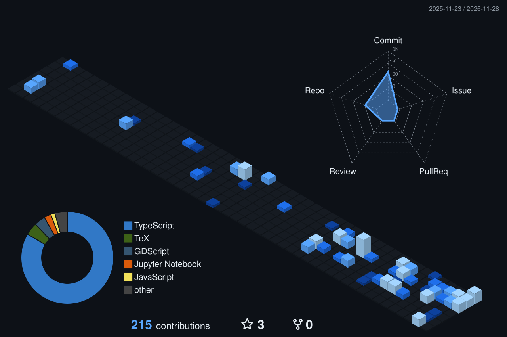

  

  

### 🧑‍💻 About me

- 🎓 Software Engineering student at **IPB University**, Bogor
- 🛠️ Building web apps with **TypeScript, React, Next.js and Laravel**
- 🎮 Learning **Godot**: [Game Feel Lab](https://github.com/Aroneru/GameFeelLab) is where I tune jumps and screen shake
- 🗺️ Also into maps: QGIS, PostGIS and Leaflet ([GeoFishery](https://github.com/Aroneru/GeoFishery))
- 🧩 I like building small tools for my own problems, like [Auto Logbook IPB](https://github.com/Aroneru/auto-logbook-ipb)
- 📍 Indonesia

### 💻 Tech stack

  

  
  
  
  
  
  

### 🚀 Projects

  
  
  
  
  
  

  More: <a href="https://ramenramein.vercel.app">RAMENRAMEiN</a> (ramen restaurant site) ·
  <a href="https://github.com/Aroneru/BISINDO">BISINDO</a> (sign language recognition) ·
  <a href="https://aroneru.github.io/us-sunlight-GIS/">US Sunlight GIS</a> (web map)

### 📊 GitHub stats

  
  

  

  
<b>📈 More stats (click to expand)</b>

   
  

    
  

### 🧊 3D contribution calendar

  

